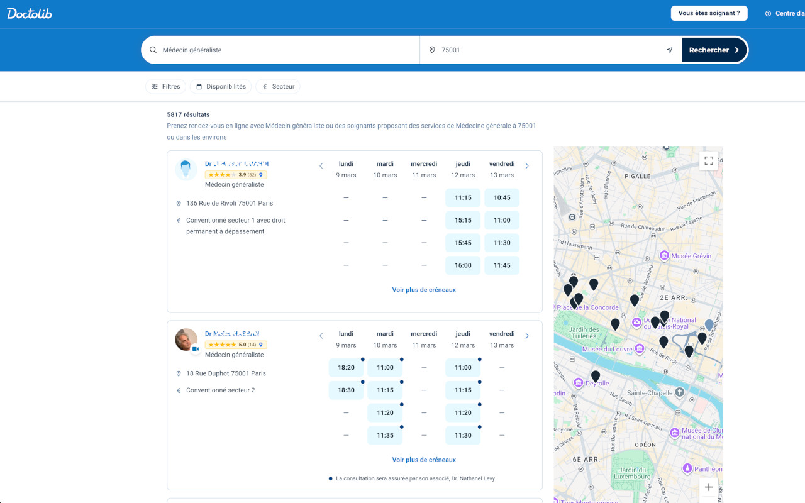
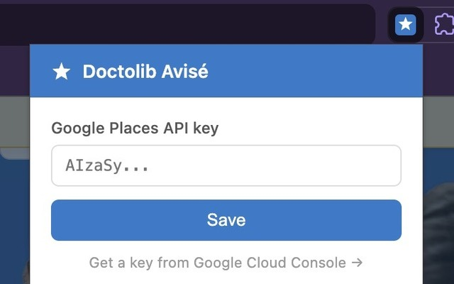

# Doctolib Avisé ⭐️

[](https://chromewebstore.google.com/detail/glhdnckepmnafedonhfdfedefahkldpl)
[](LICENSE)

Chrome extension that shows the Google Maps rating of each practitioner directly in Doctolib.fr search results.



A badge next to each practitioner's name shows the star rating, the score and the number of reviews. Clicking it opens the practitioner's Google Maps page.

The interface is available in English and French, following the browser language.

## Install

Install it from the [Chrome Web Store](https://chromewebstore.google.com/detail/glhdnckepmnafedonhfdfedefahkldpl). The extension is unlisted, so it does not show up in store search: use the link.

## Setup

The extension needs your own Google Places API key.

1. Open the [Google Cloud Console](https://console.cloud.google.com/) and create or select a project.
2. Enable [Places API (New)](https://console.cloud.google.com/apis/library/places.googleapis.com) for that project. If your project already has the legacy **Places API** enabled, that works too.
3. Create an API key on the [Credentials page](https://console.cloud.google.com/google/maps-apis/credentials). It is strongly recommended to restrict the key to **Places API (New)** under **API restrictions**, so that it cannot be used for anything else.
4. Click the **Doctolib Avisé** icon in the Chrome toolbar, paste the key and save.



The key is stored locally in Chrome and is only sent to Google.

> **Cost**: Google bills API usage to your project, with **1,000 free searches per month** on Places API (New) and 5,000 on the legacy Places API at the time of writing (see the [current pricing](https://developers.google.com/maps/billing-and-pricing/pricing)). Each practitioner shown in the results counts as one search. If you only use the extension for yourself and your family, and you are not a compulsive Doctolib user, that should be plenty.

## Development

To run the extension from source:

```bash
npm install
npm run build
```

Then open `chrome://extensions`, enable **Developer mode**, click **Load unpacked** and select the `dist/` folder.

Use `npm run watch` to rebuild on every change, and reload the extension from `chrome://extensions` to pick up the new build.

## License

MIT © 2026 [Lucas Pantanella](https://github.com/naei)
